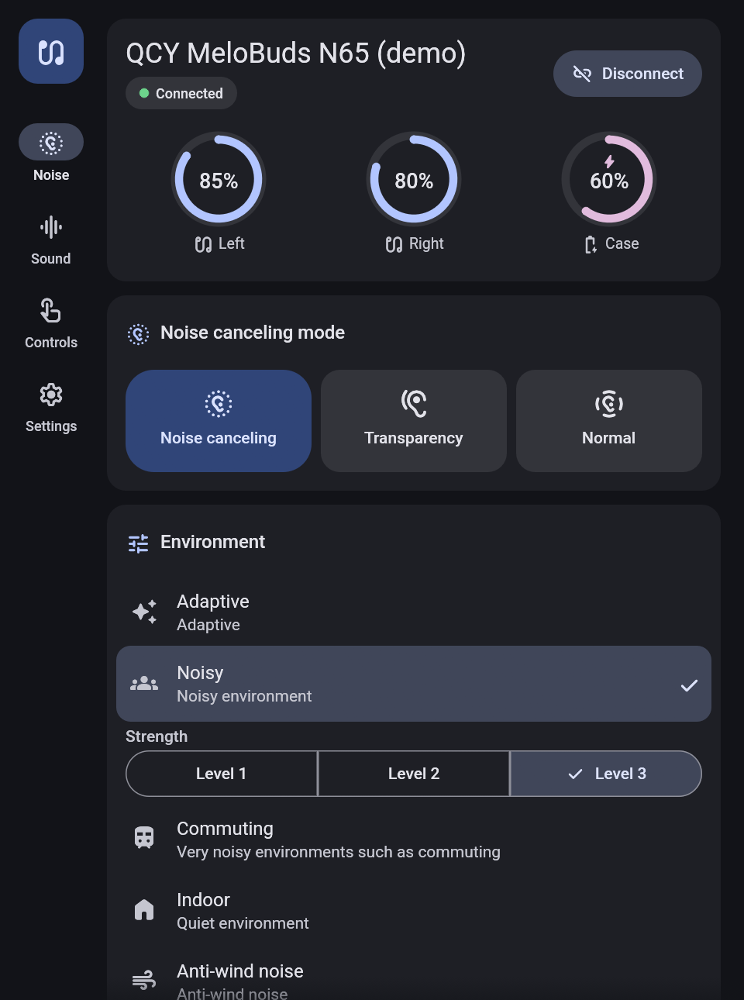
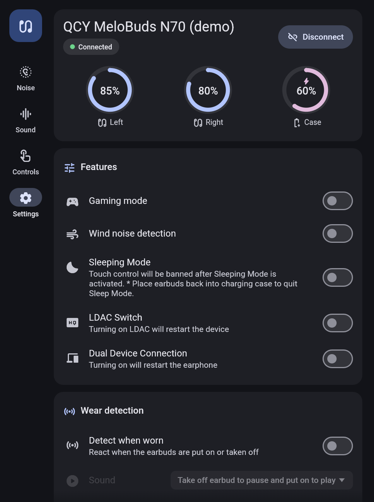
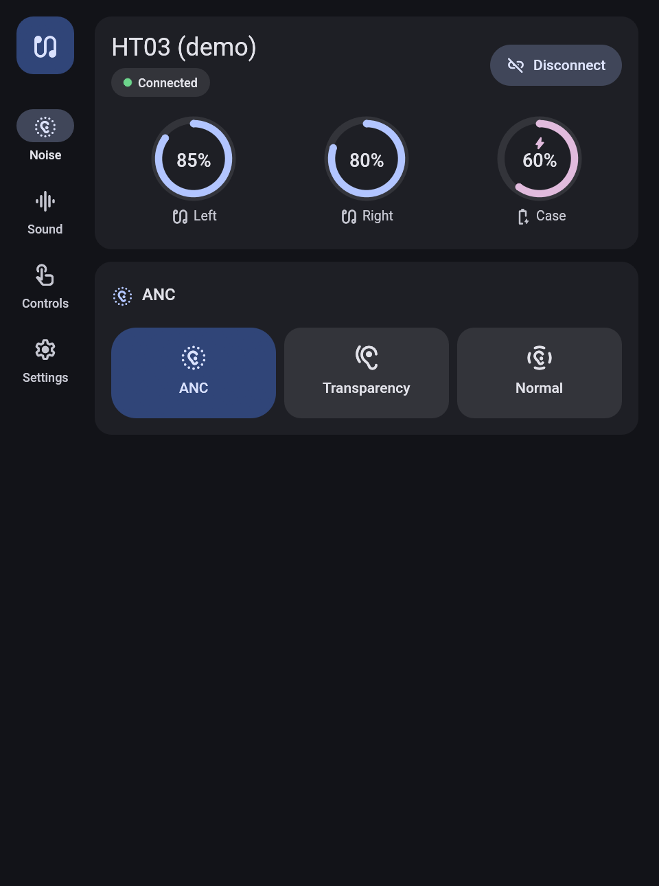
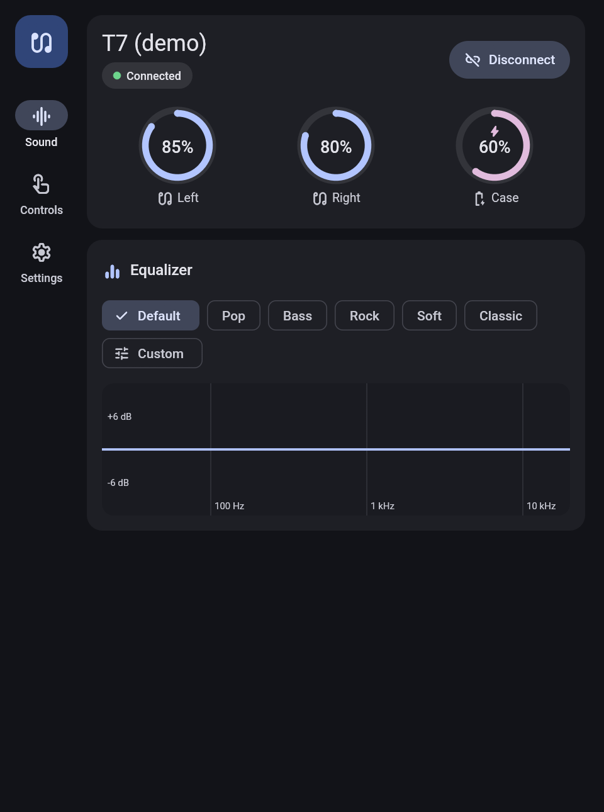

# Orphion

Control QCY earbuds from Linux and Windows.

Control QCY wireless earbuds from your computer: noise cancelling, transparency, EQ,
touch controls, dual-device connection, LDAC, wear detection and more, without
the phone app. Every model in QCY's catalogue (193 earphones, all chip
families) gets the same controls the official app shows for it.

Written in Rust. On Linux it talks to BlueZ over D-Bus (pure Rust: no
`libdbus`, no root); on Windows it uses the built-in Bluetooth LE API. No QCY
account or internet connection is needed on either. The protocol was
reverse-engineered from the official Android app and verified on real
hardware ([docs/PROTOCOL.md](docs/PROTOCOL.md)).

| Noise control | Sound | Touch controls | Settings |
|---|---|---|---|
|  |  |  |  |
|  |  |  |  |

The window adapts to each model. Some other models, shown in demo mode:

| MeloBuds N65 (JieLi) | MeloBuds N70 (WuQi) | HT03 (Realtek) | T7 (ZR) |
|---|---|---|---|
|  |  |  |  |

## What you get

| Program    | What it is                                                                 |
|------------|----------------------------------------------------------------------------|
| `orphion`  | The control panel window, in Material 3 style with light and dark themes (follows the system, or pick one under Settings → Appearance) and a choice of accent colour; the whole colour scheme is generated from it. |
| `orphion-tray` | A tray icon (KDE Plasma or any StatusNotifier host on Linux; the notification area on Windows). The tooltip shows battery levels; the menu offers the model's noise control modes, its quick switches (gaming mode, sleep mode, …) and EQ presets; clicking the icon opens the control panel. On Linux, scrolling over it cycles noise control. |
| `orphionctl`   | Command line tool for scripts and keyboard shortcuts.                      |

### Supported models and features

The official app has no per-model code: it downloads a "control panel" for
each model and builds its screens from it. This project bundles the panels
of all 193 earphones in QCY's catalogue and does the same, so each model
shows exactly its own controls, under the names QCY gives them:

- noise control with the model's modes, scenes, strength levels and voice
  focus (or its simpler mode buttons, or a strength in percent)
- equalizer with the model's presets and a custom curve over its bands
  (graphic or parametric, with the app's anti-clipping gain), game EQ
- touch gestures, headphone buttons and head gestures with the actions the
  model offers
- every switch of the model (gaming mode, sleep mode, LDAC, aptX, dual
  device, anti-wind noise, spatial sound, adaptive volume, eco mode, …),
  value lists (auto power-off, sound mode, …), voice prompt language and
  volume, sleep timer, wear detection, ear tip fit test, game mode
  settings, multipoint with the paired phones, AI noise cancelling,
  balance, earbud volume, renaming and the model's reset actions
- battery of both buds and the case, firmware version

`orphionctl models` lists every model and `orphionctl panel <id>` what it offers.

QCY uses chips from several vendors, which are driven differently. All of
them are implemented:

| Chips | Models | How | Status |
|---|---|---|---|
| WuQi, Realtek, others | 89 | QCY's own protocol | Tested on a MeloBuds Pro (firmware 2.0.6) on Linux and Windows |
| JieLi | 95 | JieLi RCSP on its own service, settings tunnelled in QCY's format | Implemented from the app's code, not yet tested on hardware |
| ZR | 9 | QCY's protocol with ZR's EQ format and key order | Implemented from the app's code, not yet tested on hardware |

If you own one of the untested models, a report (`orphionctl -vv status`
output) is very welcome.

**Firmware updates are deliberately not supported.**

## Requirements

**Linux**

- Any x86_64 distribution. Built from source it runs anywhere Rust does; the
  portable release build needs glibc 2.31+ (Ubuntu 20.04+, Debian 11+,
  Fedora 32+, RHEL/Rocky/Alma 9, openSUSE Leap 15.3+, Mint 20+, Arch, Manjaro
  and derivatives)
- BlueZ 5 with `bluetoothd` running and the adapter powered (tested with 5.87)
- For the GUI: any Wayland or X11 desktop with OpenGL: GNOME, KDE Plasma,
  Xfce, Cinnamon, MATE, Budgie, LXQt, tiling window managers. The libraries
  ship with every desktop (`libxkbcommon`, `libwayland-client`,
  `libGL`/`libEGL`) and are loaded at run time. On compositors without
  server-side decorations (GNOME) the window draws its own title bar.
- For the tray: a StatusNotifierItem host. Built in on KDE Plasma, Ubuntu's
  GNOME, Cinnamon, Budgie and LXQt; on Xfce add the "Status Notifier Plugin"
  to the panel; on plain GNOME (Fedora, Debian) install the "AppIndicator and
  KStatusNotifierItem Support" extension.
- To build: Rust ≥ 1.85 and a C linker. No `-dev` packages are needed: the
  D-Bus client is pure Rust.

**Windows**

- Windows 10 version 2004 or newer, or Windows 11 (tested on Windows 11)
- A Bluetooth adapter with Bluetooth Low Energy, using the standard Microsoft
  Bluetooth driver (nearly every laptop)
- To run: nothing to install. The programs use only DLLs that ship with
  Windows.
- To build: Rust ≥ 1.85 plus either the Visual Studio Build Tools (MSVC) or
  MinGW-w64 (GNU), see [Build on Windows](#option-b-build-on-windows).

## Install on Linux

Everything is installed for the current user; no root is needed except for
installing the build tools.

### From a release tarball (no compiler needed)

Download `orphion-<version>-linux-x64.tar.gz` from the
[releases page](https://github.com/hm-aktaruzzaman-mukdho/Orphion/releases), or build it yourself with
`packaging/build-linux.sh` (see below). On any supported distribution:

```bash
tar xzf orphion-<version>-linux-x64.tar.gz
cd orphion-<version>-linux-x64
./packaging/linux/install.sh --autostart   # or run bin/orphion directly
```

`install.sh` notices the prebuilt `bin/` folder and skips compiling. To build
from source instead, follow the steps below.

### 1. Prerequisites

Install Rust with [rustup](https://rustup.rs) (distribution packages are
often too old for edition 2024):

```bash
curl --proto '=https' --tlsv1.2 -sSf https://sh.rustup.rs | sh
```

Then a C linker and BlueZ, for example:

| Distribution     | Command |
|------------------|---------|
| Debian / Ubuntu  | `sudo apt install build-essential bluez` |
| Fedora           | `sudo dnf install gcc bluez` |
| Arch             | `sudo pacman -S --needed base-devel bluez bluez-utils` |
| openSUSE         | `sudo zypper install gcc bluez` |

Make sure the Bluetooth service runs and the adapter is on:

```bash
sudo systemctl enable --now bluetooth
bluetoothctl show        # should report "Powered: yes"; if not: bluetoothctl power on
```

### 2. Get the source

```bash
git clone https://github.com/hm-aktaruzzaman-mukdho/Orphion.git orphion
cd orphion
```

### 3. Build and install

```bash
packaging/linux/install.sh               # build and install the three programs
packaging/linux/install.sh --autostart   # same, and start the tray icon on login
```

The script runs `cargo build --release --workspace` (the first build takes a
few minutes) and installs:

| What | Where |
|------|-------|
| `orphion`, `orphion-tray`, `orphionctl` | `~/.local/bin`, or `$PREFIX/bin` with e.g. `PREFIX=~/apps packaging/linux/install.sh` (use the same `PREFIX` for `uninstall.sh`) |
| Menu entries "Orphion" and "Orphion Tray" | `~/.local/share/applications` |
| Icon | `~/.local/share/icons/hicolor/256x256/apps/orphion.png` |
| Tray autostart (`--autostart` only) | `~/.config/autostart` |

The menu entries use absolute paths, so they work even if `~/.local/bin` is
not in your `PATH`. To call `orphionctl` from a terminal, add it if needed:

```bash
echo 'export PATH="$HOME/.local/bin:$PATH"' >> ~/.bashrc
```

### 4. Pair the earbuds

Pair them for audio as usual, with your desktop's Bluetooth settings or with
`bluetoothctl`:

```bash
bluetoothctl
  scan on                  # wait until "QCY MeloBuds Pro" shows up
  pair 84:AC:60:89:A4:B0   # the address shown for your earbuds
  trust 84:AC:60:89:A4:B0
  connect 84:AC:60:89:A4:B0
  quit
```

The control link (Bluetooth LE) needs no pairing; the programs find it on
their own. Start "Orphion" from the application menu, or run `orphion`.

### Run without installing

```bash
cargo build --release
./target/release/orphion        # or orphion-tray, orphionctl
```

To try the interface without earbuds, run `orphion --demo`. It simulates a
MeloBuds Pro using data captured from real hardware.

### Update and uninstall

To update, pull the new source and run `packaging/linux/install.sh` again (quit
the tray first so the new version is started).

Before it was renamed, Orphion was called "QCY Earbuds" (`qcy-gui`,
`qcy-tray`, `qcyctl`). The installers on both systems remove such a version,
keep its tray autostart (and on Windows its `Path` entry), and Orphion picks
up its saved appearance settings.

```bash
packaging/linux/uninstall.sh
```

removes the programs, menu entries, icon, autostart entry and the settings
in `~/.config/orphion/`.

### Build a portable release tarball

A normal `cargo build` links against the glibc of the build machine, so a
binary built on a rolling distribution (Arch, Kali, Fedora rawhide) refuses
to start on older ones. `packaging/build-linux.sh` links against glibc 2.31
instead, using [cargo-zigbuild](https://github.com/rust-cross/cargo-zigbuild):

```bash
cargo install --locked cargo-zigbuild
pip install ziglang            # or the distribution's zig package
packaging/build-linux.sh       # → dist/orphion-<version>-linux-x64.tar.gz
```

The only hard dependency of the resulting binaries is glibc; everything
graphical is loaded at run time.

## Install on Windows

Everything is installed for the current user; no administrator rights are
needed.

### Option A: from a release zip

Download `orphion-<version>-windows-x64.zip` from the
[releases page](https://github.com/hm-aktaruzzaman-mukdho/Orphion/releases). A zip can also be made by
`packaging/build-windows.sh` on Linux (see
[Cross-compile from Linux](#cross-compile-from-linux)) or by the steps in
[option B](#option-b-build-on-windows). It contains `orphion.exe`,
`orphion-tray.exe`, `orphionctl.exe`, `install.ps1`, `uninstall.ps1` and a short
`README.txt`.

1. If the zip was downloaded, right-click it → **Properties** → tick
   **Unblock** → OK, before extracting. Otherwise Windows marks every file as
   coming from the internet and asks before running each one.
2. Extract it, e.g. to `Downloads\orphion-0.1.0-windows-x64`.
3. Right-click `install.ps1` → **Run with PowerShell**, or open PowerShell in
   that folder and run:

   ```powershell
   powershell -ExecutionPolicy Bypass -File install.ps1 -Autostart
   ```

The programs are not code-signed. If SmartScreen shows "Windows protected
your PC", choose **More info → Run anyway**. You can also skip installing and
run the `.exe` files straight from the extracted folder.

### Option B: build on Windows

1. **Install Rust.** Download and run `rustup-init.exe` from
   [rustup.rs](https://rustup.rs), or use `winget install Rustlang.Rustup`.
2. **Install a toolchain.** Pick one:

   - **MSVC (recommended).** Install the
     [Visual Studio Build Tools](https://visualstudio.microsoft.com/visual-cpp-build-tools/)
     with the **Desktop development with C++** workload (it includes the
     Windows SDK), e.g.:

     ```powershell
     winget install Microsoft.VisualStudio.2022.BuildTools --override "--wait --passive --add Microsoft.VisualStudio.Workload.VCTools --includeRecommended"
     ```

     rustup's default host on Windows is already `x86_64-pc-windows-msvc`.

   - **GNU, without Visual Studio.** Install MinGW-w64, for example WinLibs
     with `winget install BrechtSanders.WinLibs.POSIX.UCRT` or MSYS2's
     `mingw-w64-ucrt-x86_64-toolchain`, and make sure its `bin` folder is in
     `PATH`. Then switch Rust to the GNU host:

     ```powershell
     rustup toolchain install stable-x86_64-pc-windows-gnu
     rustup default stable-x86_64-pc-windows-gnu
     ```

     The build needs MinGW's `dlltool.exe` (the `windows` crates fail
     without it) and uses `windres.exe` to embed the program icon. Check with
     `where.exe dlltool windres`.

3. **Build**, in a new terminal (so the updated `PATH` is used) in the source
   folder:

   ```powershell
   git clone https://github.com/hm-aktaruzzaman-mukdho/Orphion.git orphion
   cd orphion
   cargo build --release
   ```

   The programs are in `target\release\`: `orphion.exe`, `orphion-tray.exe` and
   `orphionctl.exe`. They can be run from there directly.

4. **Install.** Put the programs next to the install scripts, the same layout
   as the release zip, and run the installer:

   ```powershell
   $dist = "dist\orphion-windows-x64"
   New-Item -ItemType Directory -Force $dist | Out-Null
   Copy-Item target\release\orphion.exe, target\release\orphion-tray.exe, target\release\orphionctl.exe, `
             packaging\windows\install.ps1, packaging\windows\uninstall.ps1, packaging\windows\README.txt $dist
   powershell -ExecutionPolicy Bypass -File "$dist\install.ps1" -Autostart
   ```

   To make a zip for another PC instead:
   `Compress-Archive $dist "$dist.zip"`.

### What `install.ps1` does

| What | Where |
|------|-------|
| `orphion.exe`, `orphion-tray.exe`, `orphionctl.exe`, `README.txt` | `%LOCALAPPDATA%\Programs\Orphion` |
| Start menu shortcuts "Orphion" and "Orphion tray" | `%APPDATA%\Microsoft\Windows\Start Menu\Programs\Orphion` |
| Tray at sign-in (`-Autostart`), and the tray is started right away | `shell:startup` (`Orphion tray.lnk`) |
| `orphionctl` in new terminals (`-AddToPath`) | your user `Path` |

Running copies of the GUI and tray are closed first, so running the script
again is also how you **update**.

The tray icon may land in the hidden-icons overflow (the **^** next to the
clock); drag it onto the taskbar to keep it visible.

### Pair the earbuds

Settings → **Bluetooth & devices** → **Add device** → **Bluetooth**, pick
the earbuds and use them for audio as usual. The control link (Bluetooth LE)
needs no pairing; the programs find it on their own. Start "Orphion" from
the Start menu.

### Uninstall

From the extracted or `dist` folder:

```powershell
powershell -ExecutionPolicy Bypass -File uninstall.ps1
```

It closes the programs and removes the program folder, the shortcuts, the
autostart entry, the settings (`%APPDATA%\orphion`), the endpoint cache
(`%LOCALAPPDATA%\orphion`) and, if `-AddToPath` was used, the `Path`
entry. Nothing else in your `Path` is changed.

### Cross-compile from Linux

No Windows machine is needed to build the Windows version:

```bash
rustup target add x86_64-pc-windows-gnu    # once
sudo apt install mingw-w64                 # once (Fedora: mingw64-gcc, Arch: mingw-w64-gcc)
packaging/build-windows.sh
```

This produces `dist/orphion-<version>-windows-x64/` and the matching
`.zip` with the three programs, the install scripts and `README.txt`. Install
it on the Windows PC with [option A](#option-a-from-a-release-zip).

## Usage

Pair the earbuds with your computer for audio (see the install sections
above). Then take them out of the case and start `orphion` or `orphion-tray`. The
earbuds are found automatically.

The earbuds accept only **one control connection**. If the QCY app on your
phone is connected, close it first. The programs on your computer share one
connection with each other, so the tray and the window can run together.

### Command line

Names come from the model's control panel, so they differ a little between
models. Run a command without its value to see what your model accepts.

```bash
orphionctl                                  # status: battery, firmware, every setting
orphionctl scan                             # list QCY earbuds nearby
orphionctl models melobuds                  # models this program knows (offline)
orphionctl panel 19786                      # what a model offers (offline)
orphionctl anc                              # list noise control modes and scenes
orphionctl anc noise-canceling adaptive     # MeloBuds Pro examples:
orphionctl anc noise commuting --level 2    # names can be shortened
orphionctl anc transparency --level 4
orphionctl anc transparency voice           # voice focus
orphionctl anc normal
orphionctl eq list                          # presets of this model
orphionctl eq preset heavy-bass
orphionctl eq custom 3 2 1 0 0 0 0 1 2 3    # one gain (dB) per band of the model
orphionctl set                              # list settings with values and choices
orphionctl set gaming-mode on
orphionctl set dual-device-connection on --yes   # restarts the earbuds
orphionctl set timing-power-off 60          # sleep timer, minutes or "off"
orphionctl keys                             # show gestures and their actions
orphionctl keys set right-double next-track
orphionctl wear-detection on --music pause-resume --anc on
orphionctl balance 50
orphionctl monitor                          # live view until Ctrl+C
```

Global options: `--device <MAC>` picks specific earbuds (audio or BLE
address), `--keep-connected` keeps the control link open for faster repeated
calls, and `-v`/`-vv` print debug logs or a full protocol trace.

Example KDE shortcut (System Settings → Shortcuts → Add command):
`orphionctl anc noise-canceling adaptive`.

`orphion --demo [MODEL]` opens the window with simulated earbuds of any
model, without Bluetooth.

## Troubleshooting

| Symptom | Fix |
|---|---|
| "No QCY earbuds found" | Take the buds out of the case; close the QCY phone app (it holds the only control connection, and the earbuds stop advertising while it is connected); make sure Bluetooth is on (Linux: `bluetoothctl show` reports `Powered: yes`). |
| "Bluetooth is turned off" | Switch Bluetooth on. The GUI and tray reconnect by themselves within about 30 s. |
| Connecting takes long | BLE connects can take 5–40 s while audio is streaming; the programs retry on their own. |
| Buds disconnect after toggling LDAC / dual device | Expected: the firmware reboots. The GUI and tray reconnect on their own. |
| A JieLi model connects but shows no values | Run `orphionctl -vv status` and open an issue with the output: these models are implemented from the app's code but not yet confirmed on hardware. |
| The phone app cannot connect | Quit the tray and close the GUI on the computer (or run `orphionctl` without `--keep-connected`). Windows drops an idle link a few seconds after the last program releases it. |
| Rename has no visible effect | Reconnect audio; phones cache names. Keep both buds out of the case while renaming. |
| "Bluetooth error" on Windows | Check Bluetooth is on in Settings and the adapter supports Bluetooth LE. Older adapters with vendor Bluetooth software (e.g. WIDCOMM) are not supported by Windows' BLE API. |
| Windows build fails with `error calling dlltool` | You are on the GNU toolchain without MinGW-w64 in `PATH`; install it or use MSVC (see [Build on Windows](#option-b-build-on-windows)). |
| `install.ps1` "cannot be loaded because running scripts is disabled" | Start it with `powershell -ExecutionPolicy Bypass -File install.ps1` as shown, which allows it for that one run only. |
| Need details | `orphionctl -vv status` prints a full protocol trace. GUI and tray: Linux `RUST_LOG=qcy_client=debug orphion-tray`; Windows (no console window) `$env:RUST_LOG="qcy_client=debug"; Start-Process orphion-tray.exe -RedirectStandardOutput tray.log`. |

## Project layout

```
crates/
  qcy-protocol/   pure protocol: commands, decoding, EQ maths, the three chip
                  dialects (QCY, JieLi RCSP, ZR) and every model's control panel
    data/         bundled control panels of all models (panels.json.zz)
  qcy-client/     stateful client, connection manager and the Bluetooth backends
                  (BlueZ on Linux, WinRT on Windows)
  orphion/        the control panel window (egui)
  orphion-tray/   tray applet
  orphionctl/     command line
scripts/
  update-panels.py  downloads QCY's control panels and rebuilds the bundle
docs/
  PROTOCOL.md     full protocol reference
  ARCHITECTURE.md design and how to extend it
assets/           application icon
packaging/
  build-linux.sh    portable Linux build → dist/…-linux-x64.tar.gz
  build-windows.sh  Windows cross-build → dist/…-windows-x64.zip
  make-icons.py     regenerates assets/
  linux/            install.sh, uninstall.sh, desktop entries, tarball README
  windows/          install.ps1, uninstall.ps1, zip README
research/         decompiled app, captured data and logs (see research/README.md)
```

## Disclaimer

Unofficial project, not affiliated with QCY. Protocol knowledge comes from
interoperability analysis of the publicly distributed Android app. Use at your
own risk.
