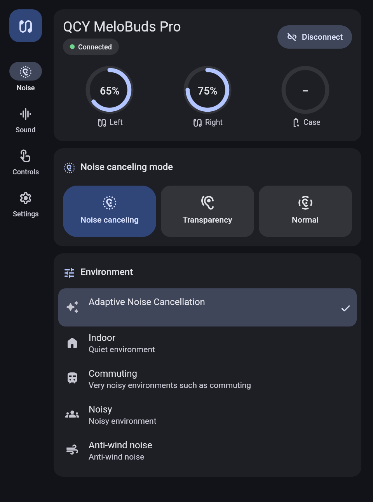
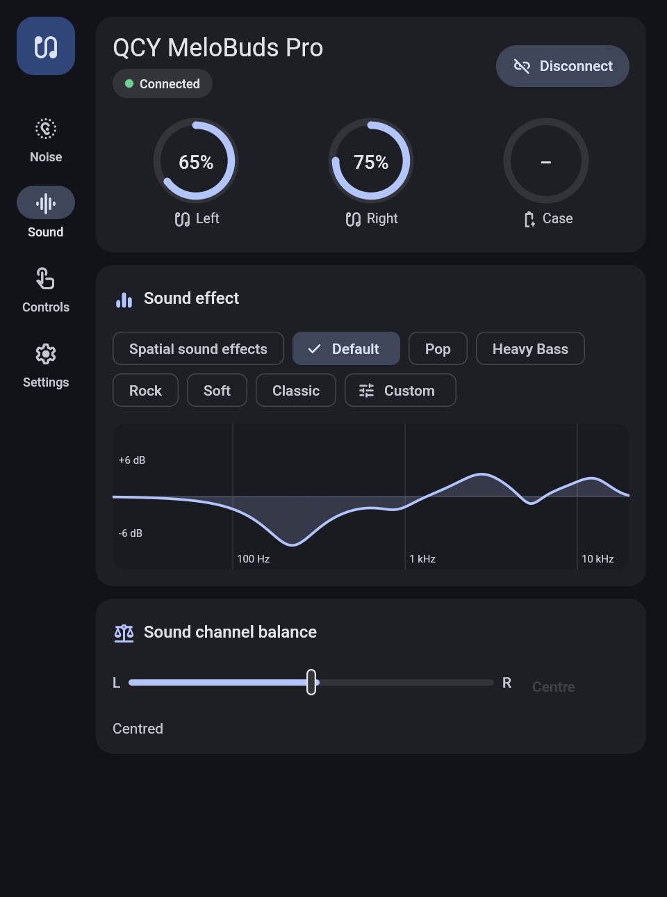
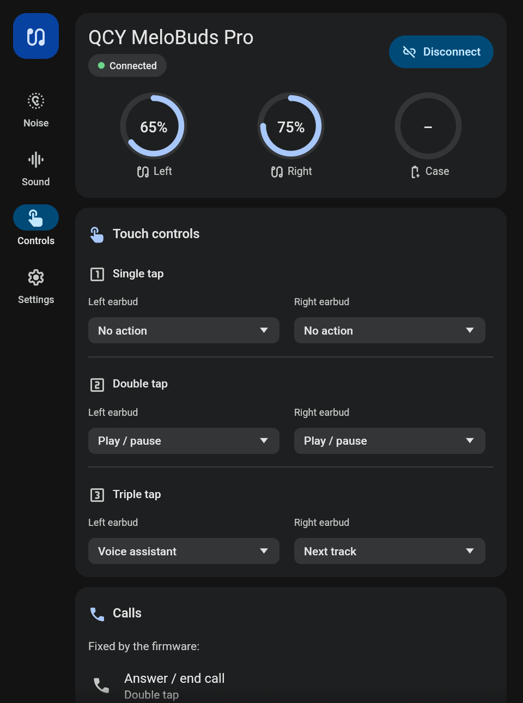
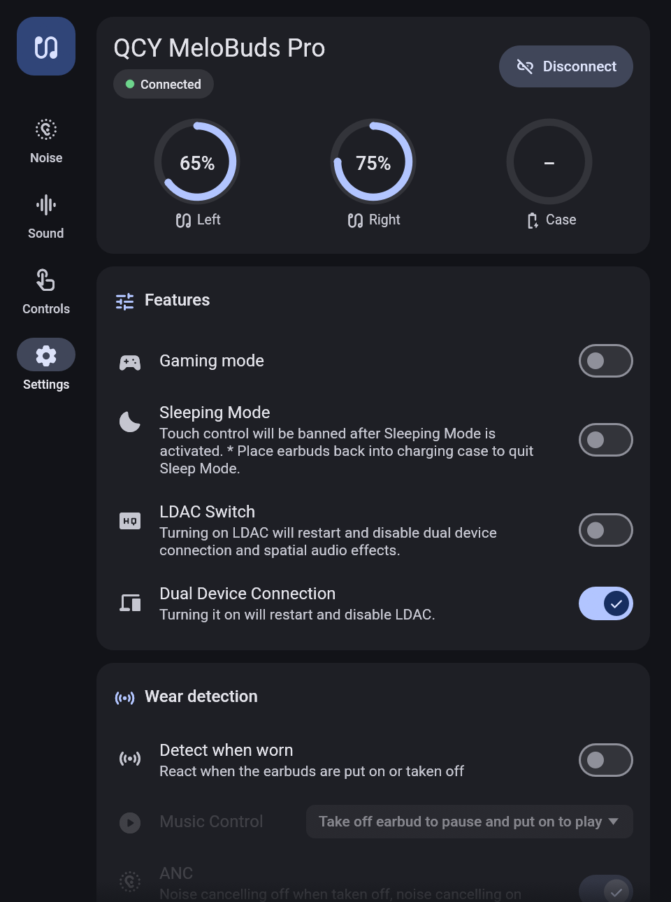
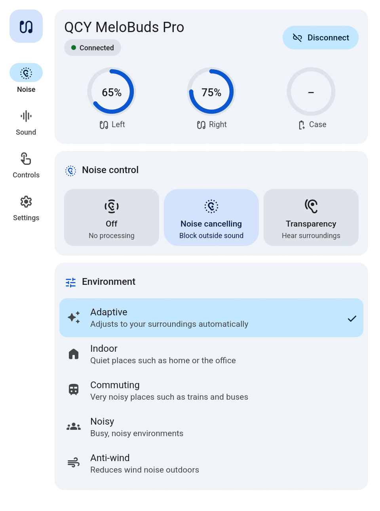
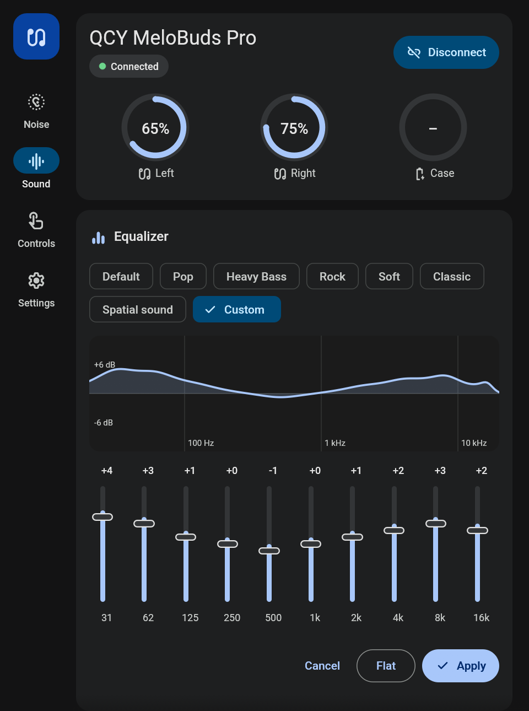
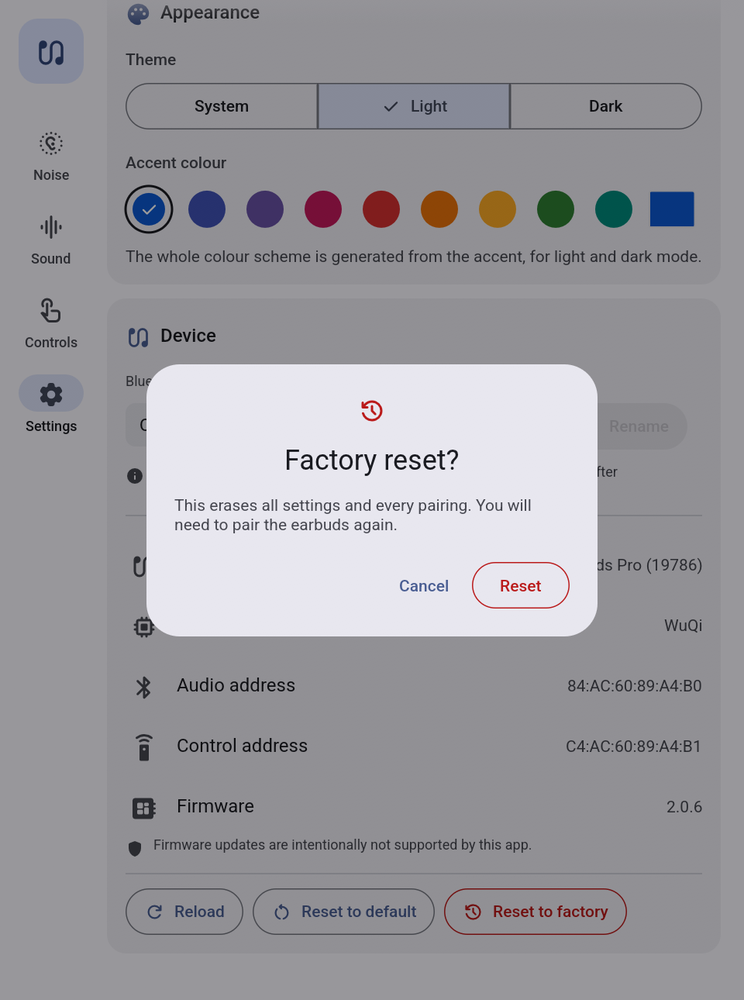
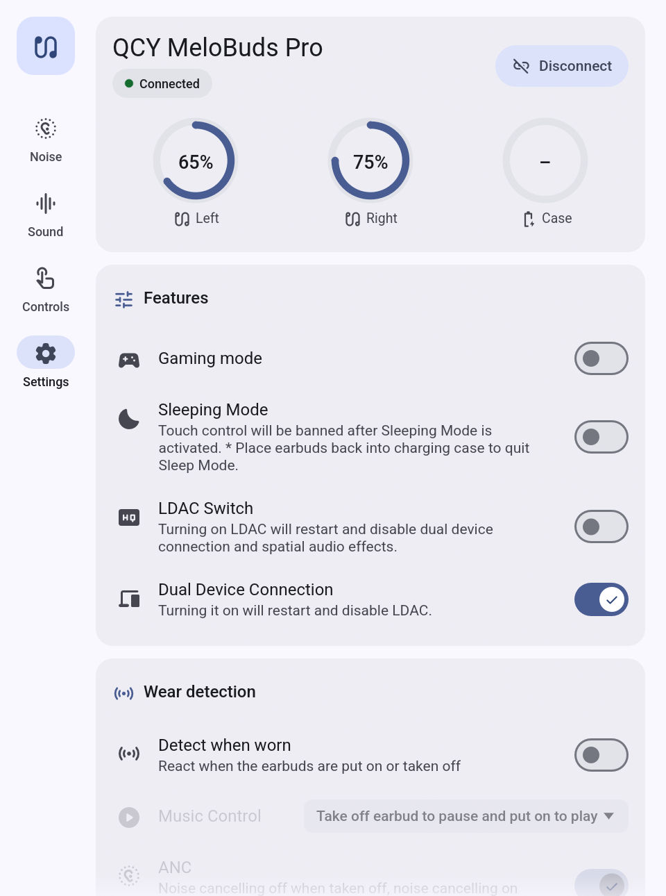

# QCY Earbuds for Linux and Windows

Control QCY wireless earbuds from your computer: noise cancelling, transparency, EQ,
touch controls, dual-device connection, LDAC, wear detection and more, without
the phone app.

Written in Rust. On Linux it talks to BlueZ over D-Bus (pure Rust: no
`libdbus`, no root); on Windows it uses the built-in Bluetooth LE API. No QCY
account is needed on either. The protocol was reverse-engineered from
the official Android app and verified on real hardware
([docs/PROTOCOL.md](docs/PROTOCOL.md)).

| Noise control | Sound | Touch controls | Settings |
|---|---|---|---|
|  |  |  |  |
|  |  |  |  |

## What you get

| Program    | What it is                                                                 |
|------------|----------------------------------------------------------------------------|
| `qcy-gui`  | The control panel window, in Material 3 style with light and dark themes (follows the system, or pick one under Settings → Appearance). |
| `qcy-tray` | A tray icon (KDE Plasma or any StatusNotifier host on Linux; the notification area on Windows). The tooltip shows battery levels; the menu offers noise control, gaming mode and EQ presets; clicking the icon opens the control panel. On Linux, scrolling over it cycles noise control. |
| `qcyctl`   | Command line tool for scripts and keyboard shortcuts.                      |

### Supported features (QCY MeloBuds Pro)

Tested on real earbuds (firmware 2.0.6, on Linux and Windows):

- Reading every setting, battery of both buds and the case, firmware versions
- Noise control: off, noise cancelling (adaptive, indoor, commuting, noisy,
  anti-wind, with strength levels), transparency levels 1–6, voice focus
- Equalizer: factory presets and a 10-band custom EQ with a live response
  curve (automatic anti-clipping gain, same as the official app)
- Touch controls: single, double and triple tap on each bud
- Gaming (low latency) mode
- Left/right balance, voice prompt volume
- Wear detection (pause/resume behaviour, ANC follows wear)
- Auto power-off after disconnect, sleep timer

Implemented byte-for-byte from the official app, but not yet exercised on
hardware:

- Voice prompt language
- Sleep mode, LDAC, dual device connection (the last two reboot the earbuds)
- Rename, restore defaults, factory reset

Other QCY models that use the same protocol (WuQi, Realtek and most other
chips) work with a generic profile: battery, touch controls, plus any
setting they report. Each extra model needs a profile to unlock its full
feature set; see [docs/ARCHITECTURE.md](docs/ARCHITECTURE.md#support-another-qcy-model).
Models with JieLi or ZR chips use different protocols and are not supported
yet.

**Firmware updates are deliberately not supported.**

## Requirements

**Linux**

- Any x86_64 distribution. Built from source it runs anywhere Rust does; the
  portable release build needs glibc 2.31+ (Ubuntu 20.04+, Debian 11+,
  Fedora 32+, RHEL/Rocky/Alma 9, openSUSE Leap 15.3+, Mint 20+, Arch, Manjaro
  and derivatives)
- BlueZ 5 with `bluetoothd` running and the adapter powered (tested with 5.87)
- For the GUI: any Wayland or X11 desktop with OpenGL: GNOME, KDE Plasma,
  Xfce, Cinnamon, MATE, Budgie, LXQt, tiling window managers. The libraries
  ship with every desktop (`libxkbcommon`, `libwayland-client`,
  `libGL`/`libEGL`) and are loaded at run time. On compositors without
  server-side decorations (GNOME) the window draws its own title bar.
- For the tray: a StatusNotifierItem host. Built in on KDE Plasma, Ubuntu's
  GNOME, Cinnamon, Budgie and LXQt; on Xfce add the "Status Notifier Plugin"
  to the panel; on plain GNOME (Fedora, Debian) install the "AppIndicator and
  KStatusNotifierItem Support" extension.
- To build: Rust ≥ 1.85 and a C linker. No `-dev` packages are needed: the
  D-Bus client is pure Rust.

**Windows**

- Windows 10 version 2004 or newer, or Windows 11 (tested on Windows 11)
- A Bluetooth adapter with Bluetooth Low Energy, using the standard Microsoft
  Bluetooth driver (nearly every laptop)
- To run: nothing to install. The programs use only DLLs that ship with
  Windows.
- To build: Rust ≥ 1.85 plus either the Visual Studio Build Tools (MSVC) or
  MinGW-w64 (GNU), see [Build on Windows](#option-b-build-on-windows).

## Install on Linux

Everything is installed for the current user; no root is needed except for
installing the build tools.

### From a release tarball (no compiler needed)

`packaging/build-linux.sh` produces
`dist/qcy-earbuds-<version>-linux-x64.tar.gz` with portable binaries (see
below). On any supported distribution:

```bash
tar xzf qcy-earbuds-<version>-linux-x64.tar.gz
cd qcy-earbuds-<version>-linux-x64
./packaging/linux/install.sh --autostart   # or run bin/qcy-gui directly
```

`install.sh` notices the prebuilt `bin/` folder and skips compiling. To build
from source instead, follow the steps below.

### 1. Prerequisites

Install Rust with [rustup](https://rustup.rs) (distribution packages are
often too old for edition 2024):

```bash
curl --proto '=https' --tlsv1.2 -sSf https://sh.rustup.rs | sh
```

Then a C linker and BlueZ, for example:

| Distribution     | Command |
|------------------|---------|
| Debian / Ubuntu  | `sudo apt install build-essential bluez` |
| Fedora           | `sudo dnf install gcc bluez` |
| Arch             | `sudo pacman -S --needed base-devel bluez bluez-utils` |
| openSUSE         | `sudo zypper install gcc bluez` |

Make sure the Bluetooth service runs and the adapter is on:

```bash
sudo systemctl enable --now bluetooth
bluetoothctl show        # should report "Powered: yes"; if not: bluetoothctl power on
```

### 2. Get the source

```bash
git clone <repository URL> qcy-earbuds
cd qcy-earbuds
```

### 3. Build and install

```bash
packaging/linux/install.sh               # build and install the three programs
packaging/linux/install.sh --autostart   # same, and start the tray icon on login
```

The script runs `cargo build --release --workspace` (the first build takes a
few minutes) and installs:

| What | Where |
|------|-------|
| `qcy-gui`, `qcy-tray`, `qcyctl` | `~/.local/bin`, or `$PREFIX/bin` with e.g. `PREFIX=~/apps packaging/linux/install.sh` (use the same `PREFIX` for `uninstall.sh`) |
| Menu entries "QCY Earbuds" and "QCY Earbuds Tray" | `~/.local/share/applications` |
| Icon | `~/.local/share/icons/hicolor/256x256/apps/qcy-earbuds.png` |
| Tray autostart (`--autostart` only) | `~/.config/autostart` |

The menu entries use absolute paths, so they work even if `~/.local/bin` is
not in your `PATH`. To call `qcyctl` from a terminal, add it if needed:

```bash
echo 'export PATH="$HOME/.local/bin:$PATH"' >> ~/.bashrc
```

### 4. Pair the earbuds

Pair them for audio as usual, with your desktop's Bluetooth settings or with
`bluetoothctl`:

```bash
bluetoothctl
  scan on                  # wait until "QCY MeloBuds Pro" shows up
  pair 84:AC:60:89:A4:B0   # the address shown for your earbuds
  trust 84:AC:60:89:A4:B0
  connect 84:AC:60:89:A4:B0
  quit
```

The control link (Bluetooth LE) needs no pairing; the programs find it on
their own. Start "QCY Earbuds" from the application menu, or run `qcy-gui`.

### Run without installing

```bash
cargo build --release
./target/release/qcy-gui        # or qcy-tray, qcyctl
```

To try the interface without earbuds, run `qcy-gui --demo`. It simulates a
MeloBuds Pro using data captured from real hardware.

### Update and uninstall

To update, pull the new source and run `packaging/linux/install.sh` again (quit
the tray first so the new version is started).

```bash
packaging/linux/uninstall.sh
```

removes the programs, menu entries, icon and autostart entry. The GUI
settings in `~/.config/qcy-earbuds/` are kept; delete that folder to remove
them too.

### Build a portable release tarball

A normal `cargo build` links against the glibc of the build machine, so a
binary built on a rolling distribution (Arch, Kali, Fedora rawhide) refuses
to start on older ones. `packaging/build-linux.sh` links against glibc 2.31
instead, using [cargo-zigbuild](https://github.com/rust-cross/cargo-zigbuild):

```bash
cargo install --locked cargo-zigbuild
pip install ziglang            # or the distribution's zig package
packaging/build-linux.sh       # → dist/qcy-earbuds-<version>-linux-x64.tar.gz
```

The only hard dependency of the resulting binaries is glibc; everything
graphical is loaded at run time.

## Install on Windows

Everything is installed for the current user; no administrator rights are
needed.

### Option A: from a release zip

A zip is made by `packaging/build-windows.sh` on Linux (see
[Cross-compile from Linux](#cross-compile-from-linux)) or by the steps in
[option B](#option-b-build-on-windows). It contains `qcy-gui.exe`,
`qcy-tray.exe`, `qcyctl.exe`, `install.ps1`, `uninstall.ps1` and a short
`README.txt`.

1. If the zip was downloaded, right-click it → **Properties** → tick
   **Unblock** → OK, before extracting. Otherwise Windows marks every file as
   coming from the internet and asks before running each one.
2. Extract it, e.g. to `Downloads\qcy-earbuds-0.1.0-windows-x64`.
3. Right-click `install.ps1` → **Run with PowerShell**, or open PowerShell in
   that folder and run:

   ```powershell
   powershell -ExecutionPolicy Bypass -File install.ps1 -Autostart
   ```

The programs are not code-signed. If SmartScreen shows "Windows protected
your PC", choose **More info → Run anyway**. You can also skip installing and
run the `.exe` files straight from the extracted folder.

### Option B: build on Windows

1. **Install Rust.** Download and run `rustup-init.exe` from
   [rustup.rs](https://rustup.rs), or use `winget install Rustlang.Rustup`.
2. **Install a toolchain.** Pick one:

   - **MSVC (recommended).** Install the
     [Visual Studio Build Tools](https://visualstudio.microsoft.com/visual-cpp-build-tools/)
     with the **Desktop development with C++** workload (it includes the
     Windows SDK), e.g.:

     ```powershell
     winget install Microsoft.VisualStudio.2022.BuildTools --override "--wait --passive --add Microsoft.VisualStudio.Workload.VCTools --includeRecommended"
     ```

     rustup's default host on Windows is already `x86_64-pc-windows-msvc`.

   - **GNU, without Visual Studio.** Install MinGW-w64, for example WinLibs
     with `winget install BrechtSanders.WinLibs.POSIX.UCRT` or MSYS2's
     `mingw-w64-ucrt-x86_64-toolchain`, and make sure its `bin` folder is in
     `PATH`. Then switch Rust to the GNU host:

     ```powershell
     rustup toolchain install stable-x86_64-pc-windows-gnu
     rustup default stable-x86_64-pc-windows-gnu
     ```

     The build needs MinGW's `dlltool.exe` (the `windows` crates fail
     without it) and uses `windres.exe` to embed the program icon. Check with
     `where.exe dlltool windres`.

3. **Build**, in a new terminal (so the updated `PATH` is used) in the source
   folder:

   ```powershell
   git clone <repository URL> qcy-earbuds
   cd qcy-earbuds
   cargo build --release
   ```

   The programs are in `target\release\`: `qcy-gui.exe`, `qcy-tray.exe` and
   `qcyctl.exe`. They can be run from there directly.

4. **Install.** Put the programs next to the install scripts, the same layout
   as the release zip, and run the installer:

   ```powershell
   $dist = "dist\qcy-earbuds-windows-x64"
   New-Item -ItemType Directory -Force $dist | Out-Null
   Copy-Item target\release\qcy-gui.exe, target\release\qcy-tray.exe, target\release\qcyctl.exe, `
             packaging\windows\install.ps1, packaging\windows\uninstall.ps1, packaging\windows\README.txt $dist
   powershell -ExecutionPolicy Bypass -File "$dist\install.ps1" -Autostart
   ```

   To make a zip for another PC instead:
   `Compress-Archive $dist "$dist.zip"`.

### What `install.ps1` does

| What | Where |
|------|-------|
| `qcy-gui.exe`, `qcy-tray.exe`, `qcyctl.exe`, `README.txt` | `%LOCALAPPDATA%\Programs\QCY Earbuds` |
| Start menu shortcuts "QCY Earbuds" and "QCY Earbuds tray" | `%APPDATA%\Microsoft\Windows\Start Menu\Programs\QCY Earbuds` |
| Tray at sign-in (`-Autostart`), and the tray is started right away | `shell:startup` (`QCY Earbuds tray.lnk`) |
| `qcyctl` in new terminals (`-AddToPath`) | your user `Path` |

Running copies of the GUI and tray are closed first, so running the script
again is also how you **update**.

The tray icon may land in the hidden-icons overflow (the **^** next to the
clock); drag it onto the taskbar to keep it visible.

### Pair the earbuds

Settings → **Bluetooth & devices** → **Add device** → **Bluetooth**, pick
the earbuds and use them for audio as usual. The control link (Bluetooth LE)
needs no pairing; the programs find it on their own. Start "QCY Earbuds" from
the Start menu.

### Uninstall

From the extracted or `dist` folder:

```powershell
powershell -ExecutionPolicy Bypass -File uninstall.ps1
```

It closes the programs and removes the program folder, the shortcuts, the
autostart entry, the settings (`%APPDATA%\qcy-earbuds`), the endpoint cache
(`%LOCALAPPDATA%\qcy-earbuds`) and, if `-AddToPath` was used, the `Path`
entry. Nothing else in your `Path` is changed.

### Cross-compile from Linux

No Windows machine is needed to build the Windows version:

```bash
rustup target add x86_64-pc-windows-gnu    # once
sudo apt install mingw-w64                 # once (Fedora: mingw64-gcc, Arch: mingw-w64-gcc)
packaging/build-windows.sh
```

This produces `dist/qcy-earbuds-<version>-windows-x64/` and the matching
`.zip` with the three programs, the install scripts and `README.txt`. Install
it on the Windows PC with [option A](#option-a-from-a-release-zip).

## Usage

Pair the earbuds with your computer for audio (see the install sections
above). Then take them out of the case and start `qcy-gui` or `qcy-tray`. The
earbuds are found automatically.

The earbuds accept only **one control connection**. If the QCY app on your
phone is connected, close it first. The programs on your computer share one
connection with each other, so the tray and the window can run together.

### Command line

```bash
qcyctl                                  # status: battery, firmware, every setting
qcyctl scan                             # list QCY earbuds nearby
qcyctl anc on --scene adaptive          # noise cancelling
qcyctl anc on --scene commuting --level 2
qcyctl anc transparency --level 4
qcyctl anc voice                        # transparency with voice focus
qcyctl anc off
qcyctl eq list                          # presets of this model
qcyctl eq preset "Heavy Bass"
qcyctl eq custom 3 2 1 0 0 0 0 1 2 3    # 10 bands, 31 Hz … 16 kHz, −8…+8 dB
qcyctl toggle dual-device on            # also: game-mode, sleep-mode, ldac
qcyctl keys                             # show touch controls
qcyctl keys set right-double next
qcyctl wear-detection on --music pause-resume --anc on
qcyctl balance 50
qcyctl auto-off 30                      # minutes, or "never"
qcyctl sleep-timer 60                   # 0 cancels
qcyctl monitor                          # live view until Ctrl+C
```

Global options: `--device <MAC>` picks specific earbuds (audio or BLE
address), `--keep-connected` keeps the control link open for faster repeated
calls, and `-v`/`-vv` print debug logs or a full protocol trace.

Example KDE shortcut (System Settings → Shortcuts → Add command):
`qcyctl anc on --scene adaptive`.

## Troubleshooting

| Symptom | Fix |
|---|---|
| "No QCY earbuds found" | Take the buds out of the case; close the QCY phone app (it holds the only control connection, and the earbuds stop advertising while it is connected); make sure Bluetooth is on (Linux: `bluetoothctl show` reports `Powered: yes`). |
| "Bluetooth is turned off" | Switch Bluetooth on. The GUI and tray reconnect by themselves within about 30 s. |
| Connecting takes long | BLE connects can take 5–40 s while audio is streaming; the programs retry on their own. |
| Buds disconnect after toggling LDAC / dual device | Expected: the firmware reboots. The GUI and tray reconnect on their own. |
| The phone app cannot connect | Quit the tray and close the GUI on the computer (or run `qcyctl` without `--keep-connected`). Windows drops an idle link a few seconds after the last program releases it. |
| Rename has no visible effect | Reconnect audio; phones cache names. Keep both buds out of the case while renaming. |
| "Bluetooth error" on Windows | Check Bluetooth is on in Settings and the adapter supports Bluetooth LE. Older adapters with vendor Bluetooth software (e.g. WIDCOMM) are not supported by Windows' BLE API. |
| Windows build fails with `error calling dlltool` | You are on the GNU toolchain without MinGW-w64 in `PATH`; install it or use MSVC (see [Build on Windows](#option-b-build-on-windows)). |
| `install.ps1` "cannot be loaded because running scripts is disabled" | Start it with `powershell -ExecutionPolicy Bypass -File install.ps1` as shown, which allows it for that one run only. |
| Need details | `qcyctl -vv status` prints a full protocol trace. GUI and tray: Linux `RUST_LOG=qcy_client=debug qcy-tray`; Windows (no console window) `$env:RUST_LOG="qcy_client=debug"; Start-Process qcy-tray.exe -RedirectStandardOutput tray.log`. |

## Project layout

```
crates/
  qcy-protocol/   pure protocol: framing, commands, decoding, EQ math, model profiles
  qcy-client/     stateful client, connection manager and the Bluetooth backends
                  (BlueZ on Linux, WinRT on Windows)
  qcyctl/         CLI
  qcy-gui/        egui control panel
  qcy-tray/       tray applet
docs/
  PROTOCOL.md     full protocol reference
  ARCHITECTURE.md design and how to extend it
assets/           application icon
packaging/
  build-linux.sh    portable Linux build → dist/…-linux-x64.tar.gz
  build-windows.sh  Windows cross-build → dist/…-windows-x64.zip
  make-icons.py     regenerates assets/
  linux/            install.sh, uninstall.sh, desktop entries, tarball README
  windows/          install.ps1, uninstall.ps1, zip README
research/         decompiled app, captured data and logs (see research/README.md)
```

## Disclaimer

Unofficial project, not affiliated with QCY. Protocol knowledge comes from
interoperability analysis of the publicly distributed Android app. Use at your
own risk.
